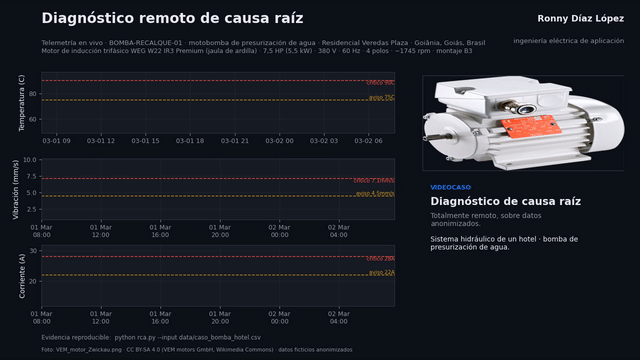
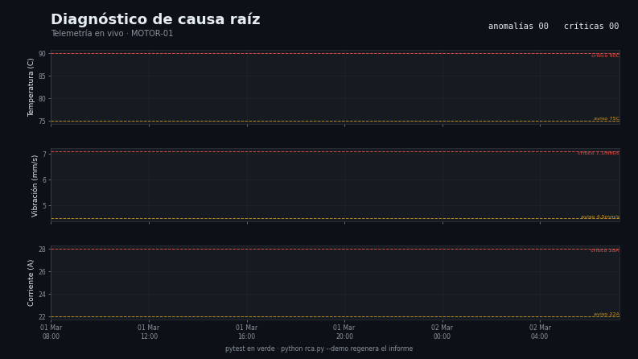

# Capa 1 — Diagnóstico y soporte técnico (causa raíz)

[`lazarolpro/rca-telemetria`](https://github.com/lazarolpro/rca-telemetria) · parte del [portafolio de 6 capacidades](https://github.com/lazarolpro/portafolio)

**Capacidad demostrada:** diagnosticar fallas por causa raíz sobre telemetría
real de un equipo, en lugar de tratar síntomas.

> © 2026 Ronny L. Díaz López. **Todos los derechos reservados.** El código fuente,
> los datos de detalle y los informes completos son propiedad del autor y no se
> publican. Prohibida su venta o uso comercial sin autorización escrita. Ver
> [`LICENSE`](LICENSE).

## Problema real

En soporte técnico el tiempo se pierde interpretando a mano registros dispersos.
Sin un método, se cambian piezas hasta que "algo funciona" y la falla vuelve.
Esta herramienta convierte telemetría cruda en un **informe de causa raíz**
accionable y reproducible.

## Qué hace

- Lee un CSV de telemetría (temperatura, vibración, corriente, código de error).
- Detecta anomalías contra umbrales de fabricante (aviso / crítico).
- Clasifica la causa probable y prioriza el equipo más afectado.
- Emite un informe Markdown con línea de tiempo y acciones recomendadas.

## Videocaso narrado — caso real anonimizado (hotel en Goiânia, Brasil)

Recorrido **narrado** de un caso real: la motobomba de presurización de agua del
hotel **Residencial Veredas Plaza** (nombre ficticio; datos anonimizados) deriva en
vibración, corriente y temperatura hasta disparar. La herramienta correlaciona las
tres señales y entrega la causa raíz, todo de forma remota.

- Video con voz en off: [`rca_demo_caso.mp4`](https://youtu.be/EAS67L_7BPw)
- Locución: **Ing. Ronny Díaz López** (voz masculina en español).

> La foto del motor es `VEM_motor_Zwickau.png` (ilustrativa), **CC BY-SA 4.0**
> (VEM motors GmbH, Wikimedia Commons); ninguna marca comercial aparece en el video.

## Demo visual (telemetría genérica)

La animación recorre la telemetría, marca las anomalías contra los umbrales del
fabricante y cierra con la causa raíz probable. Video completo:

[`rca_demo.mp4`](https://youtu.be/EAS67L_7BPw).

## Evidencia que produce

- [`assets/muestra_informe_rca.pdf`](assets/muestra_informe_rca.pdf) — muestra resumida
  del informe final (con marca de agua). El informe completo no se publica.
- `assets/rca_demo.mp4`, `rca_demo.gif`, `rca_poster.png` — demo visual animado.
- `assets/rca_demo_caso.mp4` (narrado), `rca_demo_caso.gif`, `rca_demo_caso_poster.png` — videocaso.

## Alcance de este repositorio

Este repositorio es una **vitrina del resultado**: muestra el video narrado del caso,
la animación del diagnóstico y una muestra del informe. El **código fuente** (análisis
RCA, generación de datos y render del video) y los **informes completos** son propiedad
del autor y se mantienen fuera del repositorio público.

## Stack

Python 3 (solo biblioteca estándar para el motor de análisis) y `matplotlib` + `ffmpeg`
para la capa visual. *(El código no se publica; ver `LICENSE`.)*

## Por qué le importa a la empresa

Responde a la necesidad de **resolver errores por la causa raíz** y no por el
síntoma: cada diagnóstico deja un informe auditable y repetible.
