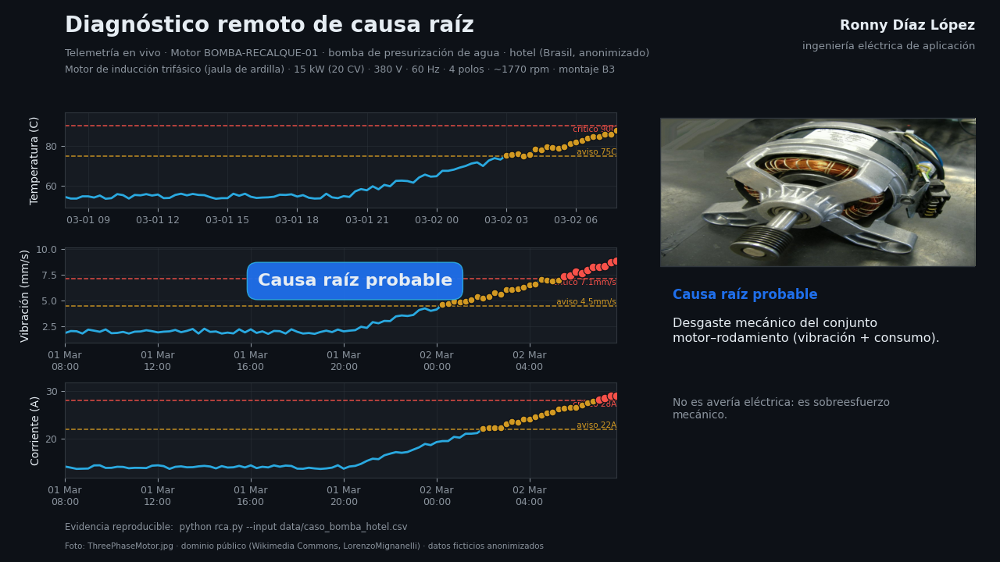

# Diagnóstico de Causa Raíz (RCA)

## Falla crítica del sistema de presurización de agua potable

**Autor:** Ronny Díaz López — ingeniería eléctrica de aplicación  
**Cliente:** Residencial Veredas Plaza (nombre ficticio) — hotel en Goiânia, Goiás, Brasil  
**Aplicación:** Motobomba de presurización / recalque de agua potable, operación 24/7  
**Equipo:** `BOMBA-RECALQUE-01`  
**Fecha del análisis:** 2026-03-02

---

## 1. Resumen ejecutivo

Pocas horas después de una intervención de mantenimiento, el motor eléctrico de la
motobomba de presurización falló y dejó al hotel sin suministro de agua presurizada
en sectores prioritarios. El análisis remoto de la telemetría, seguido de una
metodología estructurada de causa raíz, demostró que el problema **no era eléctrico
ni mecánico**: se había instalado un componente **inadecuado para la aplicación**.

**Causa raíz latente:** ausencia de un procedimiento de procura técnica homologado y
falta de verificación de la placa de características antes del montaje.

---

## 2. Metodología: los 5 Porqués

1. **¿Por qué falló el suministro de agua?**
   Porque el motor de la motobomba se quemó por un cortocircuito en el bobinado.
2. **¿Por qué se quemó el motor?**
   Porque ingresó agua y humedad al bobinado de cobre, degradando el aislamiento.
3. **¿Por qué pudo ingresar el agua?**
   Porque el motor instalado tenía protección **IP00/IP20** (carcasa abierta), sin
   sellado contra líquidos.
4. **¿Por qué se instaló un motor de carcasa abierta en un cuarto de bombas?**
   Porque se adaptó un motor diseñado para **lavadoras domésticas** (alta velocidad,
   eje con polea Poly-V), en lugar de un motor industrial de bombeo.
5. **¿Por qué se seleccionó y aprobó ese motor? (causa raíz latente)**
   Por la **falta de un procedimiento de procura técnica** y de verificación de placa
   (tensión, frecuencia, régimen, grado IP y forma constructiva) antes del montaje.

---

## 3. Evidencia técnica: desviación de lo instalado vs. lo requerido

| Parámetro | Instalado (desviación) | Requerido (ingeniería) |
| --- | --- | --- |
| Aplicación | Electrodoméstico (lavadora) | Industrial / bombeo de fluidos |
| Grado de protección | IP00 / IP20 (abierto) | **IP55** (cerrado, contra chorros de agua) |
| Frecuencia | Alta frecuencia por diseño doméstico | **60 Hz** (red de Goiânia) |
| Tensión | Incompatible con la red local | **220/380 V trifásico** |
| Régimen | Intermitente (S2/S3) | **S1 (continuo 24/7)** |
| Carcasa | Aluminio / chapa ligera | **Hierro fundido FC-200** |
| Acople / eje | Eje corto con polea Poly-V | Eje cilíndrico con chavetero (cople flexible) |
| Montaje | Compacto doméstico | **B3 (patas) sobre bancada** |
| Ventilación | Abierta / ventilada internamente | **TFVE / IC411 (totalmente cerrado)** |
| Aislamiento | No apto para régimen continuo | **Clase F (elevación térmica clase B)** |

---

## 4. Solución: motor eléctrico adecuado

Se especificó y sustituyó por un **motor eléctrico trifásico industrial WEG W22 IR3
Premium**, apto para bombeo de agua en cuarto de bombas.

| Parámetro | Valor seleccionado |
| --- | --- |
| Fabricante / línea | WEG W22 IR3 Premium (ABNT NBR 17094) |
| Potencia | 7,5 HP (5,5 kW) |
| Tensión / frecuencia | 220/380 V trifásico · 60 Hz |
| Polos / velocidad | 4 polos · ~1745 rpm |
| Grado de protección | IP55 |
| Refrigeración | TFVE / IC411 (totalmente cerrado) |
| Carcasa / tapas / caja de bornes | Hierro fundido FC-200 |
| Aislamiento | Clase F (elevación térmica clase B) |
| Régimen de servicio | S1 (continuo) |
| Eficiencia | IR3 (Premium — Portaria Interministerial nº 1/2017) |
| Forma constructiva | B3 (patas), eje cilíndrico con chavetero |
| Acoplamiento | Cople flexible a bomba centrífuga horizontal |

**Por qué este motor y no otro:** es el estándar de la industria brasileña (repuestos
y asistencia inmediata), cumple la eficiencia mínima legal y su construcción cerrada
de hierro fundido resiste el ambiente húmedo del cuarto de bombas —exactamente lo que
el motor de lavadora no podía hacer.

---

## 5. Plan de acción

### Correctivo (inmediato)

- [x] Diagnóstico RCA y comparación técnica.
- [x] Retiro del motor inadecuado y verificación de bancada, cople y alineación.
- [x] Instalación del **WEG W22 IR3 Premium 7,5 HP 4P B3 IP55 220/380 V 60 Hz**.
- [x] Pruebas funcionales: rotación, corriente, temperatura y presión de red.

### Preventivo (gobernanza)

- [ ] Procedimiento de procura técnica homologado (checklist de placa obligatorio).
- [ ] Catálogo de activos críticos con número de parte aprobado.
- [ ] Mantenimiento basado en condición (aislamiento, termografía, vibración).
- [ ] Prohibición de adaptaciones improvisadas sin aprobación de ingeniería.

---

## 6. Evidencia de la telemetría analizada



Datos **ficticios** (semilla fija) y **anonimizados**; reproducibles con:

```bash
python rca.py --input data/caso_bomba_hotel.csv
```

---

## 7. Créditos

- Fotografía del motor: `VEM_motor_Zwickau.png` — **CC BY-SA 4.0** (VEM motors GmbH,
  Wikimedia Commons). Imagen ilustrativa del tipo de motor industrial; ninguna marca
  comercial aparece en el video narrado.
- Datos de telemetría: ficticios, generados con semilla fija para reproducibilidad.
